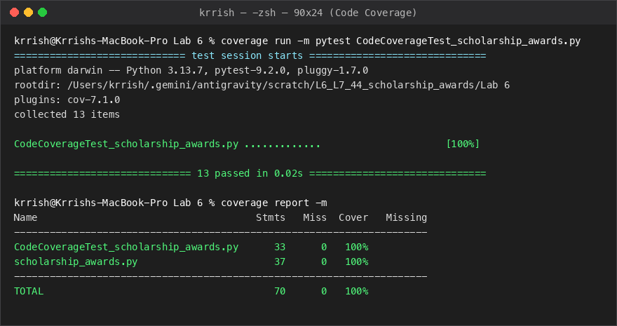
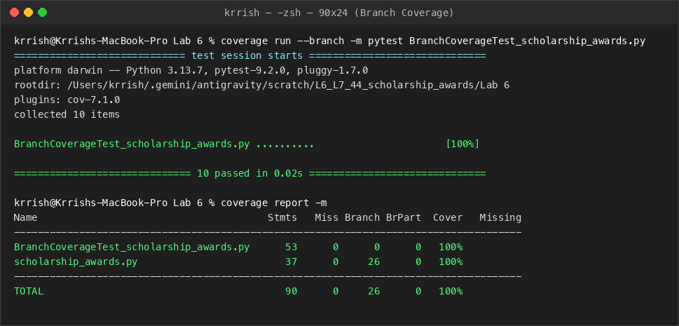

# Lab 6: Code and Branch Coverage Analysis — Scholarship Awards

## Student Information
- **Name:** Krrish P Raju
- **SRN:** PES1UG24CS708
- **Course:** UE23CS352B — Software Engineering Lab
- **Assigned Problem Statement:** #44 Scholarship Awards (`scholarship_awards.py`)
- **Institution:** PES University, Department of Computer Science and Engineering

---

## Deliverables in this Directory

| Deliverable File | Description | Verification / Status |
| :--- | :--- | :--- |
| 🐍 [`scholarship_awards.py`](./scholarship_awards.py) | **Python Application Module Under Test** | Computes scholarship award amount, eligibility, and application status. |
| 🧪 [`test_scholarship_awards.py`](./test_scholarship_awards.py) | **Comprehensive Pytest Suite** | Full pytest suite achieving 100% line & branch coverage. |
| 📊 [`CodeCoverageTest_scholarship_awards.py`](./CodeCoverageTest_scholarship_awards.py) | **Code Coverage Test Suite** | 13 targeted tests achieving **100% Statement Coverage** (37/37 statements). |
| 🌿 [`BranchCoverageTest_scholarship_awards.py`](./BranchCoverageTest_scholarship_awards.py) | **Branch Coverage Test Suite** | 10 exhaustive tests achieving **100% Branch Coverage** (26/26 branches, 0 partial). |
| 🔗 [`CodeCoverageTest_scholarship_awards_application.py`](./CodeCoverageTest_scholarship_awards_application.py) | **Deliverable Alias** | Conforms to `CodeCoverageTest_xxxx_application.py` naming convention. |
| 🔗 [`BranchCoverageTest_scholarship_awards_application.py`](./BranchCoverageTest_scholarship_awards_application.py) | **Deliverable Alias** | Conforms to `BranchCoverageTest_xxxx_application.py` naming convention. |
| 📸 [`code_coverage_report.png`](./code_coverage_report.png) | **Terminal Output Screenshot (Line Coverage)** | Demonstrates 100% line coverage report from terminal execution. |
| 📸 [`branch_coverage_report.png`](./branch_coverage_report.png) | **Terminal Output Screenshot (Branch Coverage)** | Demonstrates 100% branch coverage report from terminal execution. |

---

## Coverage Analysis Summary

| Coverage Metric | Target Threshold | Baseline (Starter Tests) | Final Test Suite | Status |
| :--- | :---: | :---: | :---: | :---: |
| **Statement (Line) Coverage** | ≥ 90% | 38% (23 missed lines) | **100% (0 missed lines)** | ✅ **Passed** |
| **Branch Coverage** | ≥ 90% | 32% (6 partial branches) | **100% (0 partial branches)** | ✅ **Passed** |

---

## Visual Reports

### 1. Code Coverage (Statement Coverage)


### 2. Branch Coverage


---

## How to Run and Verify

```bash
# Navigate to Lab-6 directory
cd "Lab-6"

# 1. Run tests and gather line coverage
coverage run -m pytest CodeCoverageTest_scholarship_awards.py
coverage report -m

# 2. Run tests and gather branch coverage
coverage run --branch -m pytest BranchCoverageTest_scholarship_awards.py
coverage report -m

# 3. Run full suite
pytest -v
```
