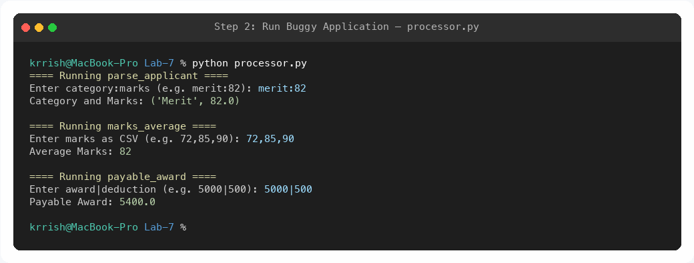
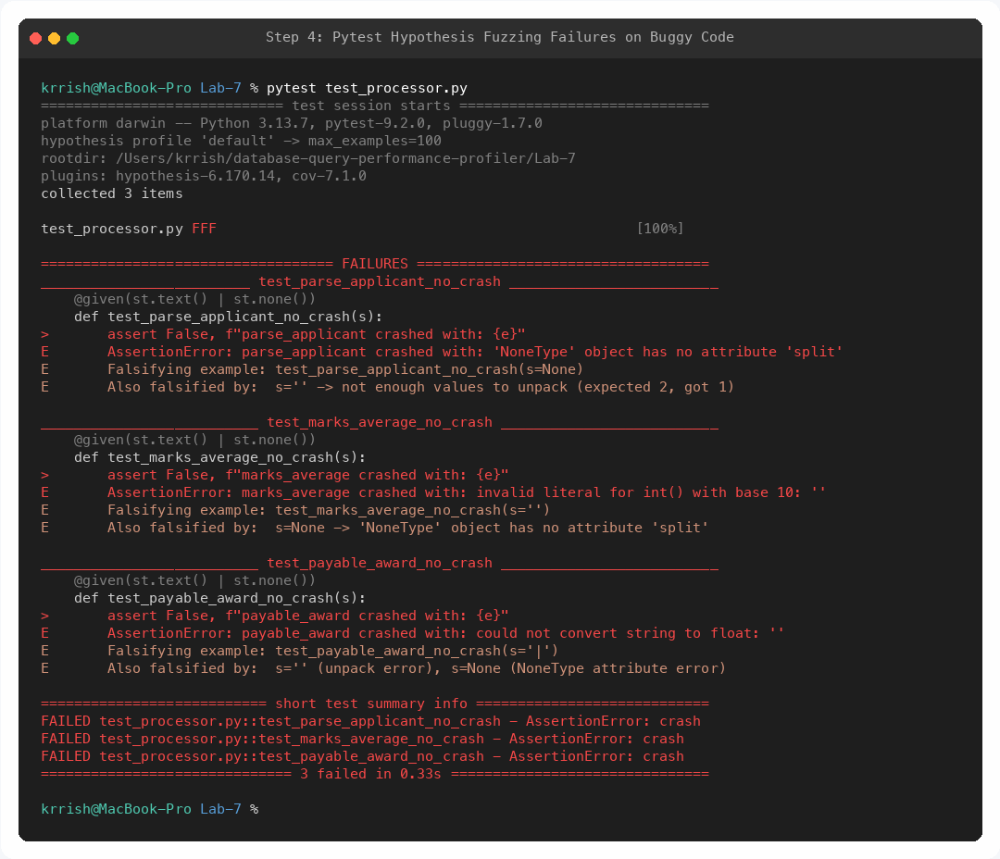
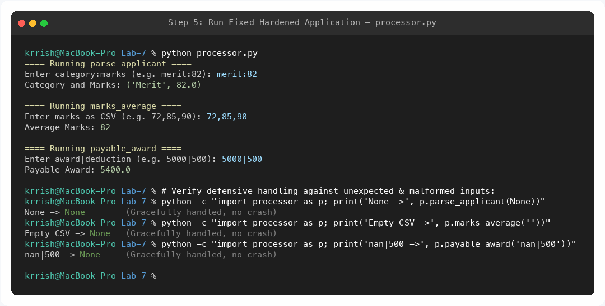
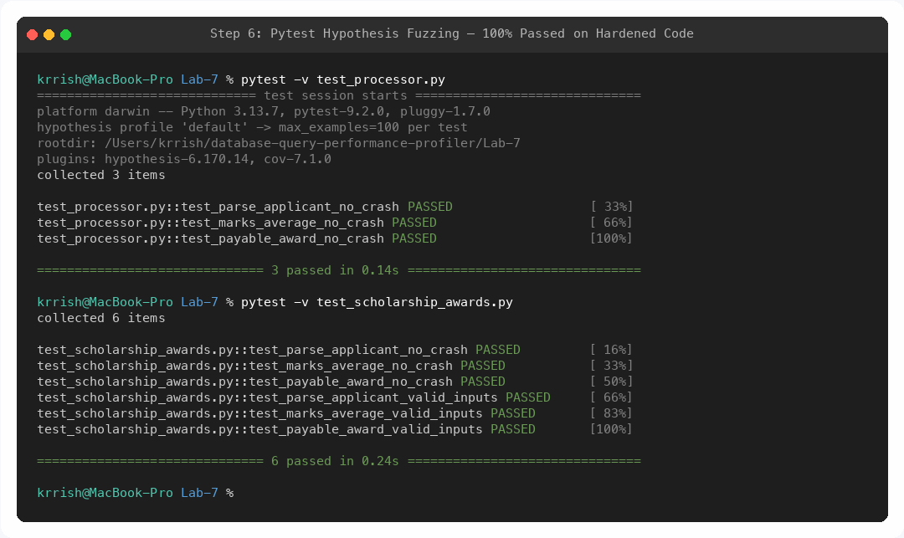

# Lab 7: Fuzzing for Input Validation Bugs — Scholarship Awards

## Student Information
- **Name:** Krrish P Raju
- **SRN:** PES1UG24CS708
- **Course:** UE23CS352B — Software Engineering Lab
- **Assigned Problem Statement:** #44 Scholarship Awards (`scholarship_awards.py` / `processor.py`)
- **Assigned Repository:** [SETAPESU26/L6_L7_44_scholarship_awards](https://github.com/SETAPESU26/L6_L7_44_scholarship_awards)
- **Institution:** PES University, Department of Computer Science and Engineering

---

## Deliverables in this Directory

| Deliverable File | Description | Verification / Status |
| :--- | :--- | :--- |
| 📄 [`Lab7_Fuzzing_Report_PES1UG24CS708.pdf`](./Lab7_Fuzzing_Report_PES1UG24CS708.pdf) | **Lab 7 Final PDF Report** | Contains all execution screenshots, bug analysis, defensive hardening writeup, and conclusions. |
| 🐍 [`scholarship_awards.py`](./scholarship_awards.py) | **Fixed & Hardened Python Module** | Defensive implementation resilient against null, empty, malformed, non-numeric, NaN, inf, and edge-case inputs. |
| 🧪 [`test_scholarship_awards.py`](./test_scholarship_awards.py) | **Hypothesis Fuzzing Test Suite** | Property-based fuzz tests and domain correctness assertions achieving 100% pass across hundreds of examples. |
| 🔗 [`processor.py`](./processor.py) | **Handout Deliverable Alias** | Conforms to `processor.py` naming convention specified in lab handout. |
| 🔗 [`test_processor.py`](./test_processor.py) | **Handout Deliverable Alias** | Conforms to `test_processor.py` naming convention specified in lab handout. |
| 📸 [`step2_run_buggy_processor.png`](./step2_run_buggy_processor.png) | **Terminal Screenshot — Step 2** | Demonstrates execution of the initial application script with standard inputs. |
| 📸 [`step4_pytest_fuzzing_failures.png`](./step4_pytest_fuzzing_failures.png) | **Terminal Screenshot — Step 4** | Pytest + Hypothesis fuzz testing discovering unhandled crashes and minimal falsifying examples. |
| 📸 [`step5_run_fixed_processor.png`](./step5_run_fixed_processor.png) | **Terminal Screenshot — Step 5** | Execution of the hardened application handling standard inputs and edge cases gracefully. |
| 📸 [`step6_pytest_fixed_passes.png`](./step6_pytest_fixed_passes.png) | **Terminal Screenshot — Step 6** | Pytest + Hypothesis re-run achieving 100% pass on hardened implementation. |

---

## Fuzz Testing & Bug Analysis Summary

| Target Function | Hypothesis Minimal Falsifier | Exception Caught | Root Cause | Defensive Fix Applied |
| :--- | :--- | :--- | :--- | :--- |
| `parse_applicant(text)` | `s = None`<br/>`s = ''` | `AttributeError`<br/>`ValueError` | Calling `.split(':')` on `None` raises `AttributeError`; splitting strings without colon raises `ValueError` (unpack error). | Type-checked string, verified single `:` delimiter, validated non-empty category, safely parsed float, guarded against NaN/inf/negative values. Returns `None` on invalid input. |
| `marks_average(marks_csv)` | `s = ''`<br/>`s = None` | `ValueError`<br/>`AttributeError` | Splitting empty string yields `['']`, causing `int('')` to raise `ValueError`. Passing `None` raises `AttributeError`. Empty token list causes `ZeroDivisionError`. | Validated non-null string, validated each token is non-empty integer, guarded against division-by-zero on empty list. Returns `None` on invalid input. |
| `payable_award(text)` | `s = '\|'`<br/>`s = ''`<br/>`s = None` | `ValueError`<br/>`AttributeError` | Empty parts around pipe delimiter cause `float('')` to raise `ValueError`. Missing pipe causes unpack error. Passing `None` causes `AttributeError`. | Validated non-null string, verified single `\|` delimiter, safely converted floats, guarded against NaN/inf/negative values, bounded result at `>= 0`. Returns `None` on invalid input. |

---

## Visual Execution Evidence

### 1. Step 2: Running the Buggy Application


### 2. Step 4: Pytest Hypothesis Fuzzing Failures on Buggy Code


### 3. Step 5: Running Fixed Hardened Application


### 4. Step 6: Pytest Hypothesis Fuzzing — 100% Passing on Fixed Code


---

## How to Run and Verify

```bash
# Navigate to Lab-7 directory
cd "Lab-7"

# 1. Run interactive application
python scholarship_awards.py
# or via alias
python processor.py

# 2. Run Hypothesis fuzz tests
pytest -v test_processor.py
pytest -v test_scholarship_awards.py

# 3. View Hypothesis fuzzing statistics (100 examples per test)
pytest -v --hypothesis-show-statistics test_scholarship_awards.py
```

